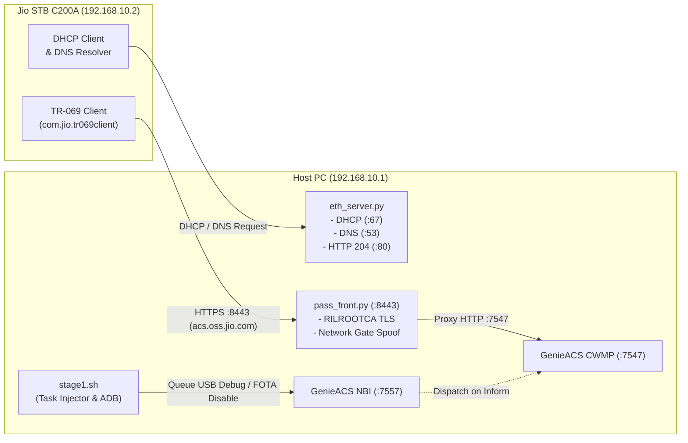
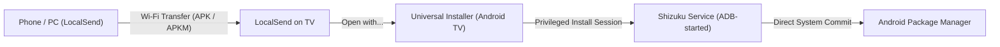

# Jio STB C200A — Stage 1 Direct LAN Exploit & Setup Guide

> **Goal:** Enable USB Debugging / Developer Options, permanently block automatic FOTA updates, and keep all JioTV+, casting, and remote features 100% functional on the **Jio STB C200A (JSTB C200Av2)** using only a direct PC-to-STB Ethernet cable. No OpenWrt router, no hotspot instability, and zero brick risk (No Stage 2 required).

---

## 📁 Self-Contained Directory Structure

This folder (`stage1_direct_lan_guide/`) is completely standalone and contains everything needed to execute the exploit from start to finish without referencing parent directories:

```text
stage1_direct_lan_guide/
├── README.md               # This comprehensive master documentation
├── eth_server.py           # All-in-one local network daemon (DHCP + DNS + Captive Portal + TLS proxy launcher)
├── fake_dns.py             # Standalone DNS spoofer (for Wi-Fi / Router method)
├── stage1.sh               # Exploit orchestrator (TR-069 task injector, ADB connector, package manager)
├── restore_and_protect.py  # Standalone package curator (restores essential features, disables updates)
└── tls/                    # Standalone Docker stack & TLS interception assets
    ├── docker-compose.yml  # GenieACS (CWMP + NBI) & MongoDB container stack
    ├── pass_front.py       # TLS reverse proxy (:8443 / :9443) with RILROOTCA token spoofing
    ├── acs.crt             # Interception SSL certificate
    ├── acs.key             # SSL private key
    ├── acs.pem             # Bundled PEM certificate
    ├── acs_chain.pem       # Complete CA trust chain
    ├── acs_oss_jio_com.cer # Jio ACS domain certificate
    └── rilrootca.pem       # Jio Root CA certificate
```

---

## 📑 Table of Contents
1. [Architecture & How It Works](#1-architecture--how-it-works)
2. [Prerequisites](#2-prerequisites)
3. [Step-by-Step Walkthrough (Method A: Direct Ethernet Cable)](#3-step-by-step-walkthrough-method-a-direct-ethernet-cable)
   - [Phase 1: Physical & Adapter Setup](#phase-1-physical--adapter-setup)
   - [Phase 2: Windows Firewall & Wi-Fi Isolation](#phase-2-windows-firewall--wi-fi-isolation)
   - [Phase 3: Launch Local ACS Stack (Docker)](#phase-3-launch-local-acs-stack-docker)
   - [Phase 4: Run Direct Ethernet Helper](#phase-4-run-direct-ethernet-helper)
   - [Phase 5: Power-Cycle STB & Trigger TR-069](#phase-5-power-cycle-stb--trigger-tr-069)
   - [Phase 6: Execute Stage 1 Injection](#phase-6-execute-stage-1-injection)
   - [Phase 7: Curate / Re-apply Protection Anytime](#phase-7-curate--re-apply-protection-anytime)
   - [Curated Package Policy (What We Keep, Disable, and Remove)](#curated-package-policy-what-we-keep-disable-and-remove)
   - [Phase 8: PC Cleanup](#phase-8-pc-cleanup)
4. [Alternative Method B: Home Wi-Fi Router (No Ethernet Port Needed)](#4-alternative-method-b-home-wi-fi-router-no-ethernet-port-needed)
5. [Critical Technical Pitfalls & Fixes (The "Gotchas")](#5-critical-technical-pitfalls--fixes-the-gotchas)
   - [Pitfall 1: Android 300-Byte Minimum DHCP Packet Drop](#pitfall-1-android-300-byte-minimum-dhcp-packet-drop)
   - [Pitfall 2: Windows Multi-NIC Broadcast Routing Bug](#pitfall-2-windows-multi-nic-broadcast-routing-bug)
   - [Pitfall 3: Captive Portal Check (generate_204)](#pitfall-3-captive-portal-check-generate_204)
   - [Pitfall 4: Windows Firewall Public Profile Dropping TCP 8443](#pitfall-4-windows-firewall-public-profile-dropping-tcp-8443)
   - [Pitfall 5: Windows Hotspot DNS / Timeout Flaws](#pitfall-5-windows-hotspot-dns--timeout-flaws)
   - [Pitfall 6: Jio Hardcoded mSuppressAppInstall & Package Verifier Deadlock](#pitfall-6-jio-hardcoded-msuppressappinstall--package-verifier-deadlock)
6. [Hardware & Usability Guide](#6-hardware--usability-guide)
   - [How to Set Up On-Device Sideloading (Universal Installer + Shizuku + LocalSend)](#how-to-set-up-on-device-sideloading-universal-installer--shizuku--localsend)
   - [How to Install Official YouTube for Android TV (from APKMirror APKM)](#how-to-install-official-youtube-for-android-tv-from-apkmirror-apkm)
   - [How to Install Gboard (Google Keyboard for Android TV)](#how-to-install-gboard-google-keyboard-for-android-tv)
   - [How to Install Apps via Aurora Store (Play Store Alternative)](#how-to-install-apps-via-aurora-store-play-store-alternative)
   - [How to Re-Pair Jio Remote Volume to Your TV](#how-to-re-pair-jio-remote-volume-to-your-tv)
   - [What Happens on Factory Reset & Fast Recovery](#what-happens-on-factory-reset--fast-recovery)

---

## 1. Architecture & How It Works

The Jio STB uses **TR-069 (CWMP)** to phone home to Jio's remote management server at `https://acs.oss.jio.com:8443`. By forging this network on your PC over a direct Ethernet cable, the STB connects to a local fake ACS server that flips the internal firmware flags:



1. **`eth_server.py`**: Acts as router, DNS server, captive portal responder, and supervisor for the TLS proxy:
   - Assigns `192.168.10.2` to the STB via RFC 2131-compliant DHCP.
   - Resolves all DNS queries for `acs.oss.jio.com` to `192.168.10.1`.
   - Replies with `HTTP 204` to Android captive portal probes so the STB marks the connection active.
   - Automatically launches `pass_front.py` on ports 8443 and 9443.
2. **`pass_front.py`**: Terminates SSL using Jio's embedded `RILROOTCA` certificate chain, spoofs the network-check gate token, and proxies CWMP traffic to GenieACS.
3. **`stage1.sh`**: Pushes parameter tasks to GenieACS NBI:
   - `Device.JioSTB.USB.USBDebugging` $\rightarrow$ `true`
   - `Device.JioSTB.USB.DebugValidityDate` $\rightarrow$ `2037-01-01T00:00:00.000Z`
   - `Device.JioSTB.FOTA.Disable` $\rightarrow$ `true`
   - `Device.JioSTB.FOTA.DowngradeEnable` $\rightarrow$ `true`
   - `Device.JioSTB.FOTA.DowngradeValidityDate` $\rightarrow$ `2037-12-31T23:59:59.000Z`
   Then connects via ADB, unlocks Developer Options, disables the dead package verifier check, freezes update packages, and cleans bloatware.
4. **`restore_and_protect.py`**: A standalone script that can be run anytime over ADB (direct LAN or home Wi-Fi) to verify and enforce the curated package policy and keep verifier checks disabled.

---

## 2. Prerequisites

### Hardware
* **Jio STB C200A** with power adapter and Jio Bluetooth/IR remote.
* **Standard RJ45 Ethernet Cable** (connects PC directly to the STB's LAN port).
* **Windows PC / Laptop** with an Ethernet port or USB-to-Ethernet adapter.
* TV or HDMI monitor.

### Software
* [Docker Desktop](https://www.docker.com/products/docker-desktop/) (running Linux containers; ensure Docker Desktop is started).
* [Python 3](https://www.python.org/downloads/) (check *"Add python.exe to PATH"* during installation) with `pycryptodome`:
  ```cmd
  pip install pycryptodome
  ```
* [Git for Windows](https://git-scm.com/download/win) (provides Git Bash for running `.sh` scripts).
* [Android Platform Tools (ADB)](https://developer.android.com/tools/releases/platform-tools) added to your system PATH (or simply place `adb.exe`, `AdbWinApi.dll`, and `AdbWinUsbApi.dll` directly inside this folder).

---

## 3. Step-by-Step Walkthrough (Method A: Direct Ethernet Cable)

All commands below should be executed from within the `stage1_direct_lan_guide/` directory.

### Phase 1: Physical & Adapter Setup
1. Connect the Ethernet cable directly between your **PC's Ethernet port** and the **Jio STB's Ethernet port**.
2. On your PC, open **PowerShell as Administrator** and assign a static IP to the Ethernet interface:
   ```powershell
   # (Optional) Check your Ethernet interface name if not sure:
   Get-NetAdapter | Select-Object Name, Status, InterfaceDescription

   # Assign static IP (replace "Ethernet" if your adapter is named differently, e.g. "Ethernet 2"):
   netsh interface ipv4 set address name="Ethernet" static 192.168.10.1 255.255.255.0 none
   ```

---

### Phase 2: Windows Firewall & Wi-Fi Isolation
1. **Temporarily turn off Windows Firewall:**
   Windows classifies direct cable links as "Unidentified Network" (Public Profile) and automatically drops inbound TCP connections on port 8443:
   ```powershell
   netsh advfirewall set allprofiles state off
   ```
2. **Turn off PC Wi-Fi:**
   Disable Wi-Fi from the Windows taskbar. *(This prevents Windows from routing DHCP broadcast packets out of the Wi-Fi card instead of the Ethernet cable).*

---

### Phase 3: Launch Local ACS Stack (Docker)
In your PowerShell terminal, navigate into `tls` and start GenieACS and MongoDB:
```powershell
cd tls
docker compose up -d
cd ..
```
Verify the stack is up and healthy:
```powershell
docker compose -f tls/docker-compose.yml ps
```
You should see `tls-genieacs-1` and `tls-mongo-1` in `running` state.

---

### Phase 4: Run Direct Ethernet Helper
Open **PowerShell as Administrator**, navigate to `stage1_direct_lan_guide`, and run:
```powershell
python eth_server.py
```
Expected output:
```text
============================================================
   Jio STB Direct Ethernet Helper (DHCP + DNS + Front-End)
   PC IP:        192.168.10.1
   STB IP:       192.168.10.2
   Broadcast IP: 192.168.10.255
============================================================
[✓] GenieACS NBI is RUNNING (http://127.0.0.1:7557)
[✓] GenieACS CWMP is RUNNING (:7547)
[*] Starting pass_front.py in background (:8443 + :9443)...
[✓] pass_front.py successfully started on :8443 + :9443!
[*] DHCP Server listening on port 67...
[*] DNS Server listening on port 53...
[*] Captive Portal server listening on port 80 (HTTP 204 responder)...
[✓] Services active. Keep this window running!
```
*Keep this terminal window running in the background.*

---

### Phase 5: Power-Cycle STB & Trigger TR-069
1. Unplug the power adapter from the Jio STB, wait 5 seconds, and plug it back in.
2. In the `eth_server.py` window, observe the network handshake:
   ```text
   [+] Received DHCP Discover from STB (...)! Sending Offer (192.168.10.2)...
   [+] Received DHCP Request from STB (...)! Sending Ack (192.168.10.2)...
   [✓] STB successfully assigned IP 192.168.10.2 and DNS 192.168.10.1!
   [+] Answered HTTP 204 (Connectivity Check) for 192.168.10.2
   [+] Resolved DNS for 'acs.oss.jio.com' from 192.168.10.2 -> 192.168.10.1
   ```

---

### Phase 6: Execute Stage 1 Injection
Open a **Git Bash** window, navigate to `stage1_direct_lan_guide`, and run:
```bash
./stage1.sh --stb-ip 192.168.10.2
```

The script will automatically:
1. Connect to GenieACS NBI (`http://localhost:7557`).
2. Wait for the STB's periodic Inform request routed through `pass_front.py`.
3. Push TR-069 tasks enabling `USBDebugging` and locking `FOTA.Disable`.
4. Connect via ADB: `adb connect 192.168.10.2:5555`.
5. Display prompt: *Check the TV screen and click **Allow** on the RSA USB Debugging dialog*.
6. Enable provisioning, Developer Options, and disable the Package Verifier:
   ```bash
   settings put global device_provisioned 1
   settings put global development_settings_enabled 1
   settings put global package_verifier_enable 0
   settings put global package_verifier_user_consent 0
   ```
7. Apply the **Curated Package Policy**:
   - Freezes `com.jio.httpupdate`, `com.jio.usbupdate`, and `com.jio.tr069client`.
   - Sets `ota_disable_automatic_update = 1`.
   - Preserves all 14 core TV, remote, casting, and launcher packages.
   - Uninstalls unneeded bloatware, telemetry, and background ad services.
8. Reload the home launcher.

Output summary:
```text
Stage 1 complete.

  Done:
    - USB debugging enabled (expires 2037)
    - Package verifier disabled (enables on-device sideloading)
    - FOTA & USB updates permanently disabled
    - TR069 client disabled & barred from background
    - JioTV+ & Live CATV streaming preserved
    - Remote voice, volume setup, & shortcuts preserved
    - Launcher deep-press popups & widgets preserved
    - Unneeded bloatware packages removed
```

---

### Phase 7: Curate / Re-apply Protection Anytime
If you ever factory reset, reconnect to home Wi-Fi, or want to verify the device's package state without re-running the exploit, run the standalone curator:
```powershell
python restore_and_protect.py
```
This utility:
- Checks and restores all 14 essential packages (`cmd package install-existing <pkg>`).
- Re-freezes update engines (`pm disable-user --user 0`).
- Disables the package verifier (`package_verifier_enable = 0`).
- Removes bloatware.
- Restarts the home launcher.

---

### Curated Package Policy (What We Keep, Disable, and Remove)

The scripts are configured with this exact balance out of the box:

#### 🟢 1. Kept Intact (14 Essential Packages)
*These remain 100% active so Live TV, phone-to-TV casting, the remote, and launcher menus work out of the box:*

| Package Name | What It Does & Why We Keep It |
| :--- | :--- |
| **`com.jio.media.stb.ondemand.patchwall`** | **JioTV+ App & Live Guide** (main Live TV interface) |
| **`com.jio.stb.catv`** | **Live TV Streaming Engine** (DVB/IPTV player backend) |
| **`com.media.jio.sso.stb`** | **Jio SSO Authentication** (keeps JioTV+ & JioCinema subscriptions active) |
| **`com.jio.dialserver`** | **DIAL Casting Server** (Cast from phone YouTube/Netflix to TV) |
| **`com.jio.stbwidget`** | **Launcher Context Popups** (enables deep-press popups on app icons) |
| **`com.jio.profileutility`** | **Launcher App Movement** (enables *"Move"*, sorting, and favorites) |
| **`com.android.app.jio.voiceassist`** | **Remote Mic & Voice Search** (Google/Jio voice search on remote) |
| **`com.jio.universalsetup`** | **Universal Remote TV Setup** (controls physical TV volume and power via IR) |
| **`com.jio.product.exploremyremote`** | **Remote Shortcut Mappings** |
| **`com.rjil.jio.stb.commandreceiver`** | **Remote Input Command Handler** |
| **`com.rjl.mobileremote.receiver`** | **JioHome Mobile Remote App Receiver** |
| **`com.jio.controlcentre`** | **Quick Settings / Control Centre Button** |
| **`com.omni.sci`** | **Core Hardware Framework** |
| **`com.omni.simplesetup`** | **Core Hardware Framework** |

---

#### 🔒 2. Strictly Disabled (3 Update & Management Packages)
*These are frozen via `pm disable-user --user 0` so Jio cannot push automatic firmware upgrades:*

| Package Name | What It Does |
| :--- | :--- |
| **`com.jio.httpupdate`** | **FOTA Auto-Updater** (Over-the-air firmware update daemon) |
| **`com.jio.usbupdate`** | **USB Firmware Updater** |
| **`com.jio.tr069client`** | **TR-069 ACS Phone-Home Client** (remote management daemon) |

*System-Level Locks Enforced:*
* `ota_disable_automatic_update = 1` (Android global setting enforced)
* `package_verifier_enable = 0` (Package verifier hang disabled)
* `Device.JioSTB.FOTA.Disable = true` (TR-069 parameter valid through year 2037)
* `Device.JioSTB.USB.USBDebugging = true` (TR-069 parameter valid through year 2037)

---

#### 🔴 3. Removed (27 Unneeded Bloatware & Telemetry Packages)
*Uninstalled via `pm uninstall --user 0` to free up RAM, stop ad injection, and clean the home screen:*

* **Unneeded Apps:**
  - `com.jio.store` (Jio App Store — replaced by Aurora Store / Universal Installer)
  - `com.jiostb.jiogames` & `com.aksys.jiogamepad` (JioGames & Gamepad helper)
  - `com.jio.media.jiobeats` & `com.jio.mymusic.app` (JioSaavn & JioMusic)
  - `com.jio.media.jionewsstb` (JioNews)
  - `com.jio.jiocloudpc` (JioCloudPC)
  - `com.jio.jiopay` & `com.jio.jiocall` (JioPay & JioCall)
  - `com.jio.yt` (Jio YouTube web wrapper — replaced by official YouTube for Android TV or SmartTube)
  - `com.jio.web` (Jio Browser)
  - `com.jio.stb.bot` (Customer service virtual chatbot / "Hello Jio")
  - `com.jio.stb.hotellauncher` (Hotel mode launcher)
  - `com.jio.screensaver` & `com.jio.stb.screensaver` (Jio promo screensavers)
  - `com.teamviewer.quicksupport.addon.jio_stb` (Remote desktop support)
* **Background Trackers, Ads & Aggressive Task Killers:**
  - `com.jio.stbadservice` (In-launcher Ad delivery engine)
  - `com.jio.systemstats` (Background telemetry & usage tracker)
  - `com.rjil.podlogservice` (Telemetry & crash log uploader)
  - `com.jio.adc.aka` & `com.jio.adc.embedded` (Analytics trackers)
  - `com.jio.smartmemorymanager` & `com.jio.appoptimizer` (Aggressive background task killers)
  - `com.jio.backgroundscheduler` (Background periodic wake-up daemon)
  - `com.jio.stb.remotediagnose` (Remote diagnostics daemon)
  - `com.jio.bioscopecontentservice` (Promotional content pre-loader)
  - `com.jiostb.inactivitytimer` (Inactivity timeout timer)

> [!NOTE]
> **Persistent system apps need a reboot to actually stop.** Some task killers above (notably `com.jio.appoptimizer`) are `PERSISTENT` privileged system apps. `pm disable-user --user 0` marks the package disabled, but its already-running process is exempt from `am force-stop` and keeps killing apps until the STB restarts. Reboot once after debloating so the disabled state takes effect.

---

### Phase 8: PC Cleanup
Now that your STB is unlocked and can connect to your regular home Wi-Fi:
1. Stop `eth_server.py` by pressing `Ctrl + C` in its terminal.
2. Turn Windows Firewall back on:
   ```powershell
   netsh advfirewall set allprofiles state on
   ```
3. Turn PC Wi-Fi back on.
4. Reset your PC's Ethernet interface back to automatic (DHCP):
   ```powershell
   netsh interface ipv4 set address name="Ethernet" dhcp
   netsh interface ipv4 set dns name="Ethernet" dhcp
   ```
5. Stop the Docker containers if desired:
   ```powershell
   cd tls
   docker compose down
   cd ..
   ```

---

## 4. Alternative Method B: Home Wi-Fi Router (No Ethernet Port Needed)

> [!TIP]
> **Use this method if your laptop does not have an RJ45 Ethernet port** or you do not have an Ethernet cable / USB-to-Ethernet adapter. You can use your existing home Wi-Fi router (JioFiber gateway, Airtel, TP-Link, etc.) as the bridge.

### The Golden Rule: Unplug the Fiber / WAN Cable!
> [!CAUTION]
> **Before powering on the STB, you MUST UNPLUG the optical fiber / broadband cable from the back of your home router.**
> The router must stay powered on to broadcast local Wi-Fi, but must have **ZERO internet access**. If the STB reaches the real internet, Jio's ACS server will detect it and push firmware updates that patch the exploit.

---

### Step-by-Step Walkthrough (Wi-Fi Method):

#### Step 1: Connect PC & STB to the Offline Router Wi-Fi
1. Unplug the optical fiber / WAN cable from the back of your home router. Verify your phone or laptop connected to Wi-Fi shows: *"Connected, No Internet"*.
2. Connect both your **PC/laptop** and the **Jio STB** to this Wi-Fi network.
3. On your PC, find your local Wi-Fi IP address:
   ```powershell
   ipconfig
   ```
   Look for **Wireless LAN adapter Wi-Fi** $\rightarrow$ **IPv4 Address** (e.g. `192.168.29.50`). Note this down.

#### Step 2: Temporarily Disable Windows Firewall
Windows Firewall blocks incoming TCP connections on port 8443 from other devices on the Wi-Fi network:
```powershell
netsh advfirewall set allprofiles state off
```

#### Step 3: Start the Docker ACS Stack
In PowerShell, navigate into `tls` and start the containers:
```powershell
cd tls
docker compose up -d
cd ..
```

#### Step 4: Run the Fake DNS Spoofer
Open a new PowerShell window as Administrator, navigate to `stage1_direct_lan_guide`, and run `fake_dns.py`:
```powershell
python fake_dns.py
```
*`fake_dns.py` automatically detects your PC's Wi-Fi IP and listens on UDP port 53. Whenever the STB queries for `acs.oss.jio.com`, it replies with your PC's IP address.*

#### Step 5: Configure the STB to Use Your PC as DNS
On your TV screen:
1. Open **Settings** $\rightarrow$ **Network & Internet** $\rightarrow$ select your connected Wi-Fi network.
2. Scroll down and choose **IP settings** $\rightarrow$ change from **DHCP** to **Static**.
3. Set the parameters:
   - **IP address:** Assign a static IP in the router range (e.g. `192.168.29.150`).
   - **Gateway:** Your router IP (e.g. `192.168.29.1`).
   - **Network prefix length:** `24`.
   - **DNS 1:** Enter **Your PC's Wi-Fi IPv4 Address** (e.g. `192.168.29.50`).
   - **DNS 2:** `8.8.8.8` (or leave as-is).
4. Save the network configuration.

#### Step 6: Execute Stage 1 & Reboot STB
1. In a **Git Bash** window, navigate to `stage1_direct_lan_guide` and run:
   ```bash
   ./stage1.sh --stb-ip 192.168.29.150
   ```
2. Unplug the power adapter from the Jio STB, wait 5 seconds, and plug it back in.
3. The STB boots up, asks your PC (`fake_dns.py`) for `acs.oss.jio.com`, connects to `pass_front.py` on your PC, and the script applies the exploit.
4. Accept the RSA USB debugging authorization prompt on your TV when it appears.

#### Step 7: Restore Normal Settings
Once Stage 1 finishes:
1. Re-enable Windows Firewall:
   ```powershell
   netsh advfirewall set allprofiles state on
   ```
2. On your STB, go back to **Network & Internet** $\rightarrow$ Wi-Fi $\rightarrow$ **IP settings** $\rightarrow$ switch back to **DHCP**.
3. Plug the optical fiber / broadband cable back into your home router.

---

## 5. Critical Technical Pitfalls & Fixes (The "Gotchas")

### Pitfall 1: Android 300-Byte Minimum DHCP Packet Drop
* **Problem:** The STB repeatedly broadcast `DHCP Discover`, received `DHCP Offer`, but immediately dropped it without sending a `DHCP Request`.
* **Root Cause:** [RFC 2131 §4.1](https://datatracker.ietf.org/doc/html/rfc2131) and RFC 1542 enforce that BOOTP/DHCP messages must be at least 300 octets. Android's DHCP client (`DhcpPacket.java`) explicitly checks:
  ```java
  public static final int MINIMUM_DHCP_SIZE = 300;
  if (packet.length < MINIMUM_DHCP_SIZE) throw new ParseException("packet too small");
  ```
  A bare-bones Python response is only ~274 bytes.
* **Fix in `eth_server.py`:**
  ```python
  if len(packet) < 300:
      packet += b'\x00' * (300 - len(packet))
  ```

---

### Pitfall 2: Windows Multi-NIC Broadcast Routing Bug
* **Problem:** When PC has both Wi-Fi and Ethernet active, `sendto('255.255.255.255', 68)` was routed out of the Wi-Fi card instead of the Ethernet cable.
* **Root Cause:** In Windows routing tables, destination `255.255.255.255` is assigned multiple routes. The route with the lowest metric wins. Typically, Wi-Fi has metric `286` while an unconfigured Ethernet link has metric `291`.
* **Fix:** Temporarily disable Wi-Fi on the host PC so the Ethernet interface is the sole active adapter, forcing all broadcast packets out of the Ethernet cable.

---

### Pitfall 3: Captive Portal Check (generate_204)
* **Problem:** The STB resolved DNS for `acs.oss.jio.com`, but then flooded DNS for `clients3.google.com` and delayed TR-069 check-ins.
* **Root Cause:** Android tests connectivity by requesting `http://clients3.google.com/generate_204` on port 80. When this failed, Android flagged the network interface as `NO_INTERNET` and throttled background service connections.
* **Fix in `eth_server.py`:** Added a lightweight HTTP daemon on port 80 that immediately answers every incoming request with `HTTP/1.1 204 No Content`.

---

### Pitfall 4: Windows Firewall Public Profile Dropping TCP 8443
* **Problem:** `eth_server.py` resolved `acs.oss.jio.com` $\rightarrow$ `192.168.10.1`, but no connections appeared in `pass_front.log`.
* **Root Cause:** Windows classifies direct cable links (without an upstream gateway) as **"Unidentified Network"** and assigns them to the **Public Firewall Profile**. By default, the Public profile drops all incoming TCP SYN packets on non-whitelisted ports.
* **Fix:** Disable firewall during the 3-minute exploit:
  ```powershell
  netsh advfirewall set allprofiles state off
  ```

---

### Pitfall 5: Windows Hotspot DNS / Timeout Flaws
* **Problem:** Using Windows 10/11 Mobile Hotspot failed because:
  1. The ICS DNS proxy ignores the Windows `hosts` file for connected hotspot clients and queries upstream internet DNS directly.
  2. If the upstream broadband connection is unplugged, modern Windows NCSI detects no internet and automatically toggles the Hotspot off within seconds.
* **Fix:** Bypassed Mobile Hotspot entirely by using the direct Ethernet connection serviced by `eth_server.py`.

---

### Pitfall 6: Jio Hardcoded `mSuppressAppInstall` & Package Verifier Deadlock
* **Problem:** When trying to install an APK from a file manager or transfer app, clicking **"Package Manager"** does nothing at all (it silently closes), or third-party installers loop infinitely on *"Staging app..."* or *"Installing..."*.
* **Root Cause 1 (Jio Sabotaged Stock Package Manager):**
  Decompiling `/system/priv-app/PackageInstaller/PackageInstaller.apk` from the firmware revealed that Jio modified the source code to deliberately kill sideloading:
  ```java
  // In InstallStart constructor:
  this.mSuppressAppInstall = true; // HARDCODED BY JIO

  // In InstallStart.onCreate():
  Log.i(TAG, "onCreate() before return");
  if (this.mSuppressAppInstall) {
      Log.i(TAG, "onCreate() return if");
      finish(); // Silently self-terminates!
      return;
  }
  ```
  Whenever any app launches the stock Package Manager, it sees `mSuppressAppInstall == true`, logs `onCreate() return if`, and kills itself immediately.
* **Root Cause 2 (Package Verifier Deadlock):**
  By default in Android, `package_verifier_enable = 1`. During any installation session, Android's `PackageManagerService` holds the installation and waits for **Google Play Protect** (`com.google.android.gms`) to verify the file. Because this STB runs pure AOSP without Google Mobile Services, the verification request goes unanswered, leaving the installer hanging in an infinite loop.
* **The Permanent Fix:**
  1. Disable package verification permanently:
     ```bash
     adb shell settings put global package_verifier_enable 0
     adb shell settings put global package_verifier_user_consent 0
     ```
  2. Use **Universal Installer** (which replaces the broken stock installer).

---

## 6. Hardware & Usability Guide

### How to Set Up On-Device Sideloading (Universal Installer + Shizuku + LocalSend)
With this setup, you can transfer any APK from your phone or PC over home Wi-Fi and install it directly on your TV without needing a computer or running ADB commands.



#### Step 1: Install Universal Installer (Android TV Release)
Because Jio's built-in package installer is hardcoded to abort, install **Universal Installer**, an open-source TV-optimized package installer:
1. Download the latest TV release APK (`UniversalInstaller-tv-release.apk`) from:
   👉 [Universal Installer GitHub Releases](https://github.com/pass-with-high-score/universal-installer/releases)
2. Sideload it via ADB:
   ```powershell
   adb install UniversalInstaller-tv-release.apk
   ```

#### Step 2: Install and Configure Shizuku
Shizuku grants Universal Installer privileged package manager access without requiring full device rooting:
1. Download the latest release from:
   👉 [Shizuku GitHub Releases](https://github.com/RikkaApps/Shizuku/releases)
2. Sideload it via ADB:
   ```powershell
   adb install shizuku-release.apk
   ```
3. Open the **Shizuku** app on your TV and read the start command from the app itself:
   - Scroll to **"Start by connecting to a computer"** and select **"View command"**.
   - Copy the command shown and run it from your PC. The path contains a per-install hash, so use it exactly as displayed. On Shizuku 13.5+ this is the native starter (older builds used a `start.sh` path that no longer exists):
     ```powershell
     adb shell /data/app/~~<hash>==/moe.shizuku.privileged.api-<hash>==/lib/arm/libshizuku.so
     ```
   - The terminal prints `info: shizuku_server pid is <pid>` once the server is running.
4. Configure it in the **Shizuku** app:
   - Confirm the home screen shows **"Shizuku is running"**.
   - Tap **"Authorized N applications"** $\rightarrow$ select **Universal Installer** $\rightarrow$ toggle its switch **ON** (e.g. "Authorized 2 applications").

> [!IMPORTANT]
> **On a non-rooted STB, Shizuku does not survive a reboot.** Its server is started over ADB and is lost on every restart. The **"Start on boot"** toggle is **rooted-devices only** (Settings $\rightarrow$ Startup $\rightarrow$ *Start on boot (root)*) and has no effect here, and this build has **no "Watchdog service" toggle** — that option only exists in some third-party forks. To restore Shizuku after a restart, either re-run the start command above, or enable **Wireless debugging** on the STB and use Shizuku's in-app **"Start via Wireless debugging"** flow to start it on-device without a PC.

#### Step 3: Install LocalSend (Seamless Wireless Transfer)
1. Download **LocalSend** for Android TV from:
   👉 [LocalSend Website](https://localsend.org/) or [LocalSend GitHub Releases](https://github.com/localsend/localsend/releases)
2. Sideload it via ADB:
   ```powershell
   adb install localsend.apk
   ```
3. Open LocalSend on both your phone/PC and your TV (make sure both are on the same Wi-Fi network).

#### How to Install Apps Anytime Without a PC:
1. From your phone or PC, select any `.apk` or `.apkm` file in LocalSend and send it to your TV.
2. When the transfer finishes on your TV, tap the file in LocalSend to open it.
3. In the "Open with" prompt, choose **Universal Installer** and click **"Always"**.
4. Universal Installer will prompt you with the TV confirmation dialog and install the app seamlessly!

---

### How to Install Official YouTube for Android TV (from APKMirror APKM)

The exploit scripts automatically remove Jio's bundled YouTube app (`com.jio.yt`), which is merely an outdated, slow web wrapper. 

To install the genuine **Google YouTube for Android TV** app:

1. **Download the APKM Bundle:**
   Download the latest release from:
   👉 [YouTube for Android TV on APKMirror](https://www.apkmirror.com/apk/google-inc/youtube-for-android-tv-android-tv/)
   *(The downloaded file will have an `.apkm` extension, which is a split APK bundle containing architecture-specific libraries).*

2. **Choose Your Installation Method:**

   * **Method A: Sideload via PC using ADB (Fastest)**
     1. Unpack the `.apkm` file (or rename the extension from `.apkm` to `.zip` and extract):
        - `base.apk`
        - `split_config.armeabi_v7a.apk` *(Jio STB C200A uses 32-bit ARM `armeabi-v7a`)*
     2. Install both split packages simultaneously via ADB:
        ```powershell
        adb install-multiple base.apk split_config.armeabi_v7a.apk
        ```
     3. The official YouTube app is now installed and ready to launch!

   * **Method B: Sideload Directly on TV (No PC Needed)**
     1. Send the downloaded `.apkm` file from your phone/PC to your TV using **LocalSend**.
     2. On your TV, tap the `.apkm` file in LocalSend.
     3. Select **Universal Installer** $\rightarrow$ Click **"Always"**.
     4. Universal Installer natively unpacks the `.apkm` bundle and installs it directly on the STB!

> [!TIP]
> If you prefer an ad-free experience with SponsorBlock and 4K playback, you can also sideload the open-source [SmartTube](https://smarttubeapp.github.io/) client using the exact same methods.

---

### How to Install Gboard (Google Keyboard for Android TV)

By default, the STB uses Jio's built-in on-screen keyboard (**JioSoftKeyBoard** / `com.jio.keyboard.swarachakra`). If you prefer the cleaner, faster, and standard **Gboard (Google Keyboard)** interface:

1. **Download the Gboard Android TV APKM:**
   Download the Android TV variant from APKMirror:
   👉 [Gboard — the Google Keyboard (Android TV) on APKMirror](https://www.apkmirror.com/apk/google-inc/gboard-the-google-keyboard-android-tv/)
   * **Target OS:** Android 10+ *(your STB runs Android 11)*
   * **Architecture:** `arm-v7a` or `universal` *(the Jio STB C200A uses 32-bit ARM `armeabi-v7a`)*

2. **Installation Methods:**
   * **Method A (ADB Multi-Package Install):**
     1. Unpack the `.apkm` file (or rename extension to `.zip` and extract):
        - `base.apk`
        - `split_config.armeabi_v7a.apk`
     2. Install both packages:
        ```powershell
        adb install-multiple base.apk split_config.armeabi_v7a.apk
        ```
     3. Enable and set Gboard as your default input method:
        ```powershell
        adb shell ime enable com.google.android.inputmethod.latin/com.android.inputmethod.latin.LatinIME
        adb shell ime set com.google.android.inputmethod.latin/com.android.inputmethod.latin.LatinIME
        ```
   * **Method B (On-Device via Universal Installer):**
     1. Transfer the `.apkm` file to your TV using **LocalSend**.
     2. Open it with **Universal Installer** and confirm install.
     3. On your TV, navigate to:
        **Settings** $\rightarrow$ **Device Preferences** $\rightarrow$ **Keyboard** $\rightarrow$ **Current Keyboard** $\rightarrow$ select **Gboard**.

---

### How to Install Apps via Aurora Store (Play Store Alternative)
Because the Jio STB runs AOSP without Google Mobile Services (GMS), the official Google Play Store app will not open without root. 

The standard solution is **Aurora Store**, which downloads APKs directly from Google Play servers:
1. Download the [Aurora Store APK](https://auroraoss.com/).
2. Sideload it via ADB:
   ```powershell
   adb install AuroraStore_4.6.x.apk
   ```
3. Open Aurora Store on your TV, choose **Session: Anonymous**, and download any app with your remote.

---

### How to Re-Pair Jio Remote Volume to Your TV
The Jio Remote's volume buttons and TV power button use **Infrared (IR)** to communicate directly with your physical TV set (Samsung, Sony, LG, Mi, etc.), **not** via the STB.

If volume controls stopped working after remote unpairing:
1. Point your Jio remote at your TV.
2. Press and hold **1** and **3** together for 3 seconds until the LED turns solid red.
3. Press and hold the **Mute** button while pointing at the TV until the TV mutes.
4. Immediately release the button and press **OK** to save the code.
5. Your remote volume buttons will now control your TV again.

---

### What Happens on Factory Reset & Fast Recovery
* **Does a factory reset wipe Developer Options?** Yes, because a factory reset clears `/data`.
* **How to recover:** Because your PC environment (`eth_server.py` + `stage1.sh`) is already configured:
  1. Plug in the Ethernet cable.
  2. Set static IP `192.168.10.1`.
  3. Run `python eth_server.py`.
  4. Run `./stage1.sh --stb-ip 192.168.10.2`.
  5. Run `python restore_and_protect.py`.
  The entire recovery takes less than **2 minutes**.
