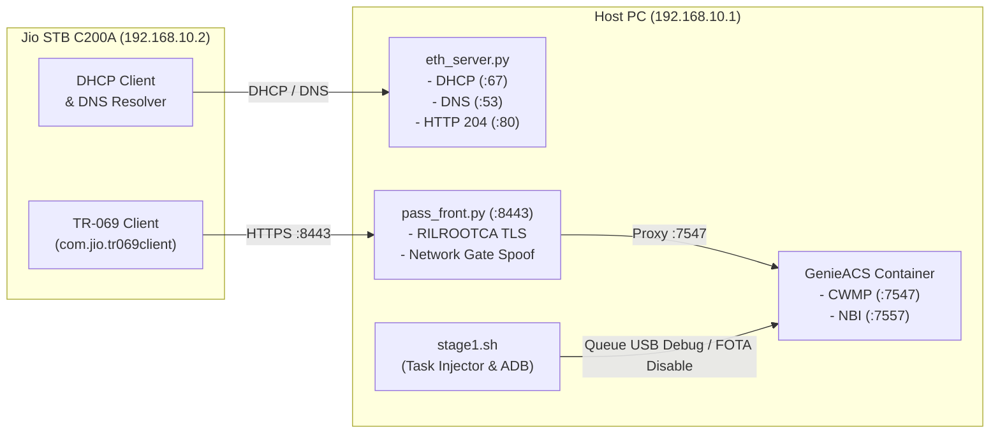

# Jio STB C200A (JMSC200A) — Comprehensive Guide: Developer Options & Custom Launcher

> Transform your **Jio 4K OTT Set-Top Box (Model C200A / JMSC200A)** into a clean, lightning-fast, ad-free streaming device. Unlock Developer Options / ADB, permanently block FOTA auto-updates, debloat over 500 MB of background telemetry, and deploy the Apple TV-style **CleanYourTV** custom launcher.

---

## ⚠️ Disclaimer & Safety First

> [!CAUTION]
> **NOTHING IS PERMANENT & ZERO BRICK RISK**
> * **Zero System Deletions**: All modifications and debloating commands perform user-level disabling (`pm disable-user --user 0`). No `/system` files are modified or deleted. Every package can be re-enabled at any time.
> * **The Physical Reset Button**: If anything ever freezes, misbehaves, or you wish to revert completely to the factory state, **press and hold the physical RESET pinhole / button on the back of the STB** while powering on. This immediately wipes `/data` and returns the STB to its out-of-the-box factory state.
> * **Enthusiast Project**: This repository is provided for educational, research, and personal hobbyist use. Modifying local network traffic and device configurations is done at your own discretion.

---

## 🤖 Why an AI Agent is Strongly Recommended

This project is divided into two distinct steps with very different requirements:

```text
┌────────────────────────────────────────────────────────────────────────────────────────┐
│                                   PROJECT LIFECYCLE                                    │
└────────────────────────────────────────────────────────────────────────────────────────┘
         │
         ├───▶ [STEP 1] Enable Developer Options & Block FOTA
         │     • Nature: MOSTLY MANUAL / SCRIPT-ASSISTED
         │     • Requires: Physical Ethernet cable, PC static IP, Docker ACS stack.
         │     • Guide: See 'Enable DeveloperOptions/' directory.
         │
         └───▶ [STEP 2] Custom Launcher & Debloating (CleanYourTV)
               • Nature: STRONGLY PREFERRED VIA AI AGENT (Interactive)
               • Why NOT rigid scripts?
                 - STB firmware versions, app libraries, and user setups vary widely.
                 - You may use SmartTube instead of standard YouTube, Spotify / VLC
                   instead of JioCinema, or custom streaming apps (Zee5, SonyLIV, Stremio).
                 - AI inspects installed packages (`pm list packages -3`), asks your
                   exact button mapping and layout preferences, compiles/configures,
                   and validates live results using real-time screenshots.
               • Guide: Feed 'Custom Launcher/PROMPT.md' to your AI Coding Assistant.
```

> [!TIP]
> **Use an AI Coding Assistant for Step 2!**
> Instead of running rigid shell scripts that make assumptions about your installed apps and remote key bindings, open this repository in an AI coding assistant (**Claude Code, Gemini CLI, Cursor, Antigravity, Copilot, or ChatGPT**) and paste the prompt in [`Custom Launcher/PROMPT.md`](Custom%20Launcher/PROMPT.md).
>
> The agent will:
> 1. Connect to your STB over ADB and scan your actual installed streaming apps.
> 2. Ask how you want the 5 physical remote hotkeys mapped (Netflix, Hotstar, JioCinema, YouTube, JioTV+).
> 3. Ask your column layout preference (4, 5, or 6 columns) and wallpaper rotation.
> 4. Safely disable 28 telemetry daemons while preserving Bluetooth remote drivers and JioTV+ SSO.
> 5. Take live screenshots to verify your setup directly on your TV.

---

## 📁 Repository Structure

```text
STB-Comprehensive Guide/
├── README.md                      # Master onboarding & lifecycle guide (this file)
├── .gitignore                     # Git ignore rules for caches, OS files, and screencaps
│
├── Enable DeveloperOptions/       # [STEP 1] TR-069 Direct LAN Exploit & Setup
│   ├── README.md                  # Comprehensive direct Ethernet exploit documentation
│   ├── eth_server.py              # Local DHCP + DNS + Captive Portal (204) + TLS supervisor
│   ├── fake_dns.py                # Standalone DNS spoofer (for router/Wi-Fi alternative)
│   ├── stage1.sh                  # Exploit orchestrator (TR-069 task injector & ADB connector)
│   ├── restore_and_protect.py     # Standalone package curator & verifier check protector
│   └── tls/                       # Interception certificates & Docker stack
│       ├── docker-compose.yml     # GenieACS (CWMP + NBI) & MongoDB stack
│       ├── pass_front.py          # Reverse TLS proxy with Jio RILROOTCA token spoofing
│       └── *.pem, *.crt, *.key    # Jio ACS certificates and interception keys
│
└── Custom Launcher/               # [STEP 2] CleanYourTV Launcher Deployment & Debloating
    ├── PROMPT.md                  # Master prompt for interactive AI Agent deployment
    ├── README.md                  # Detailed launcher documentation & technical overview
    ├── app-release.apk            # Pre-compiled CleanYourTV release APK
    ├── config.xml                 # Custom launcher configuration & hardware keymaps
    ├── app_library_settings_menu.patch # Source patch for Settings menu & dynamic opacity
    ├── deploy_jio_stb.ps1         # Fallback one-shot deploy script for Windows PowerShell
    ├── deploy_jio_stb.sh          # Fallback one-shot deploy script for Linux / macOS / Bash
    ├── restore_jio_stb.ps1        # Rollback script to stock Iwedia launcher (Windows)
    ├── restore_jio_stb.sh         # Rollback script to stock Iwedia launcher (Bash)
    └── theme/                     # 14 high-resolution dark landscape wallpapers
        ├── config.json            # Theme metadata & rotation schedule
        ├── screenshot.jpg         # Visual preview of the clean Apple TV-style home screen
        └── wallpapers/            # 14 scenic wallpapers (Dusk peaks, Aurora, etc.)
```

---

## 🛠️ Prerequisites

### Hardware
* **Jio STB C200A** (Model `JMSC200A` running Android 11).
* **Standard RJ45 Ethernet Cable** (connects PC directly to the STB LAN port).
* **Windows, Linux, or macOS PC** with an Ethernet port (or USB-to-Ethernet adapter).
* **TV or HDMI Monitor** connected to the STB.
* **Jio Bluetooth/IR Remote**.

### Software
* [Docker Desktop](https://www.docker.com/products/docker-desktop/) (must be installed and running Linux containers).
* [Python 3](https://www.python.org/downloads/) with `pycryptodome`:
  ```bash
  pip install pycryptodome
  ```
* [Android Platform Tools (ADB)](https://developer.android.com/tools/releases/platform-tools) installed and added to your system `PATH`.
* [Git](https://git-scm.com/) (provides Git Bash for running `.sh` scripts on Windows).

---

## 🚀 Step 1: Enable Developer Options & Block FOTA

> **Nature**: Mostly manual and script-assisted.
> **Full Guide**: [`Enable DeveloperOptions/README.md`](Enable%20DeveloperOptions/README.md)

The Jio STB phones home to Jio's remote management server via **TR-069 (CWMP)** at `https://acs.oss.jio.com:8443`. By forging this network on your PC over a direct Ethernet cable, the STB connects to a local GenieACS server that permanently unlocks Developer Options and freezes automatic FOTA updates.



### Quick Execution Steps

1. **Connect Cable & Set Static IP**:
   * Connect PC to the STB using an RJ45 Ethernet cable.
   * On Windows (PowerShell as Administrator):
     ```powershell
     netsh interface ipv4 set address name="Ethernet" static 192.168.10.1 255.255.255.0 none
     ```
2. **Network Isolation**:
   * Turn off Wi-Fi on your PC (prevents DHCP broadcasts from routing out of Wi-Fi).
   * Temporarily disable Windows Firewall:
     ```powershell
     netsh advfirewall set allprofiles state off
     ```
3. **Start Local ACS Stack (Docker)**:
   ```bash
   cd "Enable DeveloperOptions/tls"
   docker compose up -d
   ```
4. **Launch Local Network Daemon**:
   ```bash
   cd "../"
   python eth_server.py
   ```
5. **Power-Cycle the STB**:
   * Unplug and re-plug the STB power adapter.
   * The terminal will log DHCP assignment (`192.168.10.2`), captive portal HTTP 204 checks, and TLS proxy handshakes.
6. **Inject Exploit Tasks**:
   * Open a new Git Bash or terminal window:
     ```bash
     cd "Enable DeveloperOptions"
     ./stage1.sh --stb-ip 192.168.10.2
     ```
   * Stage 1 queues the flags (`USBDebugging=true`, `FOTA.Disable=true`), connects via ADB, disables the package verifier deadlock, and applies initial debloating.
7. **Cleanup PC Network**:
   * Stop `eth_server.py` (`Ctrl+C`), re-enable Windows Firewall, and reconnect PC Wi-Fi:
     ```powershell
     netsh advfirewall set allprofiles state on
     netsh interface ipv4 set address name="Ethernet" dhcp
     ```

---

## 🎨 Step 2: Custom Launcher Deployment & Debloating (CleanYourTV)

> **Nature**: Strongly recommended via AI Agent.
> **Master Prompt**: [`Custom Launcher/PROMPT.md`](Custom%20Launcher/PROMPT.md)
> **Full Guide**: [`Custom Launcher/README.md`](Custom%20Launcher/README.md)

Once Developer Options and ADB are enabled, connect the STB to your home Wi-Fi network and note its IP address from **Settings $\rightarrow$ Network & Internet**.

### Option A: The AI Agent Workflow (Recommended)

1. Open this repository in your AI coding assistant (**Claude Code, Gemini CLI, Cursor, Antigravity, Copilot, or ChatGPT**).
2. Copy and paste the prompt found in [`Custom Launcher/PROMPT.md`](Custom%20Launcher/PROMPT.md).
3. The AI agent will interactively:
   * Connect via `adb connect <STB_IP>:5555`.
   * Discover installed apps (`pm list packages -3`).
   * Ask how you want physical remote buttons assigned:
     * **Netflix** (`KEYCODE_F7`)
     * **JioHotstar** (`KEYCODE_F8`)
     * **JioCinema** (`KEYCODE_F9` $\rightarrow$ customize to Spotify, VLC, Kodi, etc.)
     * **YouTube** (`KEYCODE_F10` $\rightarrow$ customize to SmartTube or standard YouTube)
     * **JioTV+** (`KEYCODE_F6`)
   * Ask your column preferences (4, 5, or 6 columns).
   * Deploy `CleanYourTV` (`app-release.apk`), configure `HomeKeyService` and `InputKeyService`.
   * Set up native Android TV settings access and fix Wi-Fi SSID permissions.
   * Safely disable 28 telemetry and ad services, freeing ~500 MB of RAM while strictly preserving JioTV+ SSO and Bluetooth remote drivers.
   * Push the 14 rotating dark landscape wallpapers via `ThemeProvider`.
   * Take live ADB screencaps to verify the clean setup on your screen!

### Option B: Fast Turnkey Shell Scripts (Fallback)

If you prefer standard factory defaults (Netflix, Hotstar, JioCinema, YouTube, JioTV+ with 4 columns per row) without customization:

* **Windows (PowerShell)**:
  ```powershell
  cd "Custom Launcher"
  .\deploy_jio_stb.ps1 -TvHost <STB_IP>
  ```
* **Linux / macOS (Bash)**:
  ```bash
  cd "Custom Launcher"
  chmod +x deploy_jio_stb.sh
  ./deploy_jio_stb.sh <STB_IP>
  ```

### Reverting to Stock Launcher Anytime

If you ever wish to return to the stock Jio Iwedia launcher:
```powershell
cd "Custom Launcher"
.\restore_jio_stb.ps1 -TvHost <STB_IP>
```
*(This restores the stock launcher and settings while safely keeping your TR-069 and FOTA update blocks intact).*

---

## 📦 What Makes This Setup Better?

| Feature | Stock Jio STB Experience | CleanYourTV + Stage 1 Debloated |
| :--- | :--- | :--- |
| **Home Screen** | Cluttered Reliance ads, sponsored banners, slow UI | Minimalist, Apple TV-style dock, zero ads |
| **Free RAM** | ~350 MB free (stutters and drops frames) | **~850 MB free (~500 MB RAM freed)** |
| **Settings App** | Locked Jio proprietary settings (`priority=999`) | Native Android TV Settings (`MainSettings`) |
| **Remote Hotkeys** | Hardcoded to Jio apps | Customizable to SmartTube, Spotify, VLC, etc. |
| **FOTA Updates** | Silent automatic updates that lock features | **Permanently disabled** via CWMP & package freeze |
| **Screensaver** | Jio ad screensaver | Ambient Apple TV-style `ClockDream` over landscapes |
| **Telemetry** | 28 active background trackers syncing data | **Disabled** via safe `pm disable-user --user 0` |

---

## 📲 Post-Setup: Essential Apps & Sideloading

For a complete guide on sideloading without a PC, setting up official YouTube TV, Gboard, Aurora Store, and re-pairing remote volume, see:
* [How to Set Up On-Device Sideloading (Universal Installer + Shizuku + LocalSend)](Enable%20DeveloperOptions/README.md#how-to-set-up-on-device-sideloading-universal-installer--shizuku--localsend)
* [How to Install Official YouTube for Android TV](Enable%20DeveloperOptions/README.md#how-to-install-official-youtube-for-android-tv-from-apkmirror-apkm)
* [How to Install Gboard (Google TV Keyboard)](Enable%20DeveloperOptions/README.md#how-to-install-gboard-google-keyboard-for-android-tv)
* [How to Install Apps via Aurora Store (Play Store Alternative)](Enable%20DeveloperOptions/README.md#how-to-install-apps-via-aurora-store-play-store-alternative)
* [How to Re-Pair Jio Remote Volume to Your TV](Enable%20DeveloperOptions/README.md#how-to-re-pair-jio-remote-volume-to-your-tv)

---

## ❓ Frequently Asked Questions (FAQ)

### What happens if I perform a factory reset?
A factory reset clears `/data`, which reenables stock packages and removes ADB debugging. However, because your host PC scripts and Docker environment are already set up, you can restore Developer Options and the custom launcher in **less than 2 minutes**:
1. Connect Ethernet cable.
2. Run `python eth_server.py`.
3. Run `./stage1.sh --stb-ip 192.168.10.2`.
4. Deploy the launcher via `PROMPT.md` or `deploy_jio_stb.ps1`.

### Can my STB get bricked?
No. All package modifications use `pm disable-user --user 0` rather than deleting system partitions. If anything ever goes wrong, simply press the physical **RESET** button on the back of the device.

### Does JioTV+ and casting still work?
Yes! The package curation scripts deliberately preserve the Jio Single Sign-On service (`com.media.jio.sso.stb`) and Bluetooth remote driver (`com.jio.remote.btserver`), ensuring JioTV+, casting, and your remote remain 100% operational.

---

## 📄 License & Credits
* Built for the Jio STB community.
* CleanYourTV launcher developed by [gathin](https://github.com/gathin/cleanyourtv).
* GenieACS open-source CWMP server by [GenieACS](https://genieacs.com/).
